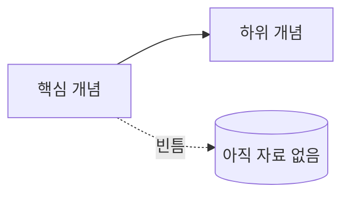

# 알다 리포트

순서는 바꾸지 않는다: **알다(내 노트) → 웹 → 빈틈 → 개념 지도 → 초안 저장**.

## 1. 알다 MCP 먼저
- `alda_search`(query, k=8~12)로 주제 키워드 2~4개를 각각 찾는다. 동의어·영문 표기도 한 번씩.
- 주제의 핵심 인물·개념은 `alda_entity`(name)로 엔티티 페이지를 읽는다. 목록이 필요하면 `alda_list`.
- 필요하면 `alda_ask`(question, save=true)로 한 번 종합을 받는다. 답은 대화 노트로 저장돼 다음 밤 색인 때 위키에 들어간다.
- 알다가 돌려준 `[[노트]]` 링크를 근거로 쓴다. 알다 결과에 없는 내 노트 내용은 지어내지 않는다.
- 알다 MCP가 없거나 오류면(Ollama 꺼짐 등) 그 사실을 보고서 맨 위에 적고 볼트 grep으로 대신한다: `~/obsidian/Obsidian 2025/` 의 `PKM/20 wiki/index.md` 먼저.

## 2. 웹검색 보강
- 내 노트가 답하지 못한 질문만 웹에서 찾는다(WebSearch → 필요한 곳만 WebFetch).
- 웹 근거는 `[W1]` 식 번호와 URL·접속일. 내 노트 근거 `[[노트]]`와 섞지 않는다.
- 수치는 출처가 있는 것만 쓴다. 없으면 "예시"로 표시한다.

## 3. 빈틈 분석
표 하나로: `질문 | 내 노트가 말하는 것([[근거]]) | 웹이 더한 것([W#]) | 아직 빈 곳 | 다음에 모을 자료`.
서로 다른 주장이 있으면 양쪽을 다 적고 합치지 않는다.

## 4. mermaid 개념 지도

- 노드 이름은 알다 엔티티 이름을 그대로 쓴다. 빈틈은 점선과 `(( ))`·`[( )]` 모양으로 구분한다.

## 5. 초안 저장
- 경로: `~/obsidian/Obsidian 2025/PKM/30 output/<하위>/<YYYY-MM-DD 제목>.md` (하위: 설교·논문·강의·글 중 맞는 것, 애매하면 `글/`).
- 프론트매터(볼트 7속성 + α):
  ```yaml
  type: report
  aliases: []
  description: "<다음 세션이 열지 판단할 한 문장>"
  author: 김병곤
  date created: YYYY-MM-DD
  date modified: YYYY-MM-DD
  tags:
    - 알다/리포트
  topic: "<HQ 3자리 코드>"
  status: draft
  sources:
    - "[[근거 노트]]"
  model: <이 세션 모델 id>
  verified: 미확인
  ```
- 본문: `## 요약` → `## 내 노트가 말하는 것` → `## 웹 보강` → `## 빈틈` → `## 개념 지도` → `## 근거`.
- `status`는 언제나 `draft`. 완성(final) 처리와 정본 폴더 이동은 사람이 한다.
- 원본 노트는 고치지 않는다. 쓰는 곳은 이 초안 하나다. `PKM/20 wiki/log.md`에 한 줄 남긴다.
- CEO 좌석 링크는 autolink 훅이 붙이므로 직접 만들지 않는다.

## 하지 않는 것
- 유료 API·클라우드 모델로 내 노트 본문을 보내지 않는다(알다는 로컬).
- 개인정보 필터로 빠진 노트(상담·심방·연락처 등)를 찾아 읽으려 하지 않는다.
